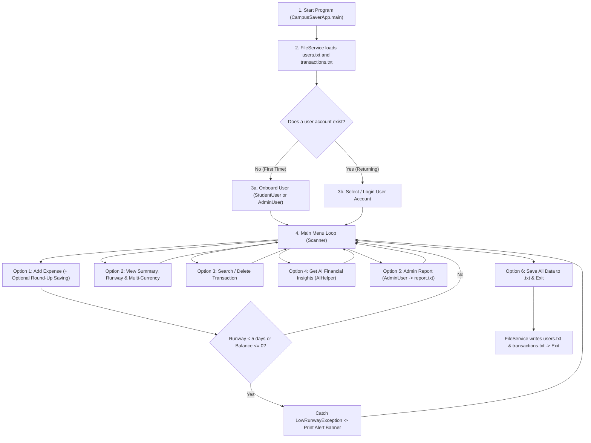
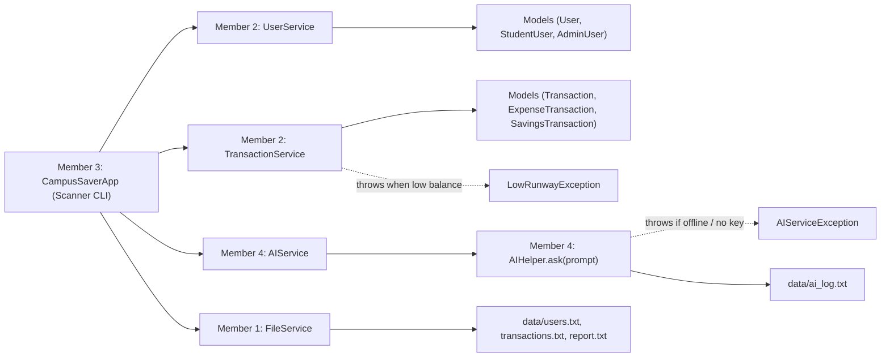

# CampusSaver — Complete Guide, Architecture & Team Tutorial

> **Welcome to CampusSaver!**  
> This guide is written for **every team member**, It explains **what the app does**, **how all the Java files connect**, **exactly what each of the 4 members needs to build**, and **how to pass every WIX1002 FOP Hackathon requirement cleanly**.

---

## 1. What is CampusSaver? (The Core Idea)

**CampusSaver** is a Java terminal (`Scanner`) application that acts as a **financial survival calculator and personal finance tracker for university students**.

### The Student Problem
Many university students receive a fixed monthly allowance, parental stipend, or scholarship payout at the start of the month. Overspending during the first two weeks on non-academic items (cafes, food delivery, entertainment) often leaves them short of cash for textbooks, printing, lab materials, or basic meals by Week 3 or Week 4.

### How CampusSaver Solves It
Instead of just storing a boring list of expenses, CampusSaver actively protects the student's **monthly financial runway**:
1. **Tracks Spending by Category & Necessity**: Separates **academic necessities** (`isVerifiedAcademic = true`) from **non-academic discretionary spending** (`false`).
2. **Spare-Change Round-Up Savings** *(from `README.md`)*: Whenever a student logs an expense like `RM 7.40`, CampusSaver can automatically calculate the spare change up to the next Ringgit (`RM 0.60`) and save it into a `SavingsTransaction` emergency jar.
3. **Calculates Burn Velocity & Runway Days**: Tracks how fast money is leaving each day and predicts how many days the remaining budget will last.
4. **Early Warning Guard (`LowRunwayException`)**: Automatically triggers a warning if remaining money or runway days drop below a safe threshold.
5. **Multi-Currency Display** *(from `README.md`)*: Stores amounts cleanly in `MYR`, while letting international or travelling students view their balance/summary converted into `USD`, `SGD`, or `IDR`.
6. **Real AI Financial Coach (`AIHelper` + `AIService`)**: Sends spending stats and category patterns to an AI model via `AIHelper.ask(prompt)` for personalized tips, logs every reply to `ai_log.txt`, and gracefully falls back to offline math tips if there is no internet or API key (`AIServiceException`).
7. **Saves Everything Locally (`.txt` Files)**: Saves users, transactions, AI logs, and summary reports (`report.txt`) into plain text files so nothing is lost when the program closes.

### UN SDG Alignment (Required for Hackathon Pitch)
- **UN SDG 4 (Quality Education)**: Helps students protect funds for academic essentials (books, lab fees, supplies) and learn healthy budgeting habits.
- **UN SDG 8 (Decent Work & Economic Growth — Financial Inclusion)**: Builds practical financial resilience and emergency savings habits among young adults.

---

## 2. Big-Picture Application Flow (Start to Finish)

Read this diagram from **top to bottom**. Every box shows one step in the user's journey when they run `CampusSaverApp`:



### Quick Text Summary of the Menu Loop
```text
=== CampusSaver CLI Menu ===
Logged in as: Ali (STUDENT | Base Currency: MYR)
1. Add New Expense (with Optional Spare-Change Round-Up)
2. View Financial Summary, Runway & Currency Converter
3. Search or Delete a Transaction
4. Get AI Financial Advice
5. [Admin Only] View All Users & Export report.txt
6. Save Data & Exit
Select an option (1-6):
```

---

## 3. How All 12 Classes & 4 Teammates Connect

Think of CampusSaver in **4 simple layers**, like a restaurant:
- **Layer 1 — Menu / Waiter (`main/CampusSaverApp`)**: Talks to the user with `Scanner`, shows menus, and catches errors so the app never crashes.
- **Layer 2 — Kitchen Logic (`service/`)**: Does all calculations (`UserService`, `TransactionService`, `AIService`).
- **Layer 3 — Storage & External Tools (`service/FileService`, `service/AIHelper`)**: Reads/writes `.txt` files and calls the AI HTTP API.
- **Layer 4 — Data Blueprints & Errors (`model/`, `exception/`)**: Simple Java objects (`User`, `Transaction`) and custom exceptions (`LowRunwayException`, `AIServiceException`).



### Role Assignment Summary (4 Members)

| Member | Files Owned | Status | Plain-English Responsibility |
| :--- | :--- | :---: | :--- |
| **Member 1** | `FileService.java`, `AdminUser.java` | `[To Build]` | Reads/writes `.txt` files on startup & exit; adds `AdminUser` role and writes `data/report.txt`. |
| **Member 2** | `UserService.java`, `TransactionService.java`, `SavingsTransaction.java` | `[To Build]` | Stores `User[]` and `Transaction[]` plain arrays, adds expenses + spare-change round-ups, throws `LowRunwayException`. |
| **Member 3** | `CampusSaverApp.java` | `[Update Stub]` | Builds the interactive `Scanner` menu loop, safe input helpers, onboarding, and multi-currency display (`MYR/USD/SGD/IDR`). |
| **Member 4** | `AIHelper.java`, `AIService.java` | `[To Build + Update]` | Updates `AIService` to use plain arrays (`Transaction[]`, `int count`) instead of `List`, builds `AIHelper.ask(String)` using `HttpURLConnection` + `config.txt` + `ai_log.txt`, and handles `AIServiceException` offline fallback. |

> **Already Done in Repo (`model/` & `exception/`):**  
> `User.java`, `StudentUser.java`, `Transaction.java`, `ExpenseTransaction.java`, `AIServiceException.java`, and `LowRunwayException.java` are already created and ready to use!

---

## 4. Core Math & Business Rules Explained Simply

Every formula below uses simple Java arithmetic (`+`, `-`, `*`, `/`, `Math.ceil`):

### A. Academic Spending Ratio
Measures how much of your total spending went to genuine study needs (`isVerifiedAcademic == true`).
$$\text{Academic Ratio (\%)} = \left( \frac{\text{Academic Spent}}{\text{Total Spent}} \right) \times 100$$
*Example:* You spent `RM 200` total, and `RM 60` was for textbooks (`isVerifiedAcademic = true`).  
`Academic Ratio = (60 / 200) * 100 = 30.0%`. (Below `40%` triggers a warning to cut non-academic spending!)

### B. Daily Burn Velocity
Measures your average spending per day so far this month:
$$\text{Daily Velocity} = \frac{\text{Total Spent}}{\text{Days Passed in Month}}$$
*Example:* You spent `RM 300` in the first `10` days of the month.  
`Daily Velocity = 300 / 10 = RM 30.00 per day`.

### C. Estimated Runway Days
Predicts how many more days your remaining money will survive at your current pace:
$$\text{Remaining Budget} = \text{Monthly Budget Limit} - \text{Total Spent}$$
$$\text{Runway Days} = \frac{\text{Remaining Budget}}{\text{Daily Velocity}}$$
*Example:* Monthly budget is `RM 800`. You spent `RM 300`, so `RM 500` is left. At `RM 30/day`:  
`Runway Days = 500 / 30 = 16 days`.  
*Business Rule (`LowRunwayException`):* Whenever `Remaining Budget <= 0` OR `Runway Days < 5` (configurable threshold), `TransactionService` throws `LowRunwayException` so `CampusSaverApp` warns the student immediately!

### D. Spare-Change Round-Up Savings (`SavingsTransaction`)
When a student adds an expense, CampusSaver calculates the change to the nearest whole Ringgit:
```java
double roundedUp = Math.ceil(expenseAmount);
double spareChange = Math.round((roundedUp - expenseAmount) * 100.0) / 100.0;
```
*Example:* Lunch costs `RM 7.40`. `Math.ceil(7.40)` is `8.00`. `spareChange = 8.00 - 7.40 = RM 0.60`.  
If `spareChange > 0` and the user says `Y` to round up, `TransactionService` creates a `SavingsTransaction` for `RM 0.60`!

### E. Multi-Currency Display
All numbers are stored cleanly in `MYR` inside `transactions.txt` so math never drifts. When viewing Summary (Option 2), the student can toggle display currency using simple rate constants:
- `MYR`: `1.00`
- `USD`: `0.22` (`1 MYR ≈ 0.22 USD`)
- `SGD`: `0.30` (`1 MYR ≈ 0.30 SGD`)
- `IDR`: `3500.0` (`1 MYR ≈ 3,500 IDR`)

---

## 5. Survival Guide: Plain Arrays (NO `ArrayList` / `HashMap`!)

> [!IMPORTANT]
> **CRITICAL WIX1002 COURSE RULE:**  
> In WIX1002, you are **NOT allowed** to use `ArrayList`, `LinkedList`, `HashMap`, or `List<...>` to store objects!  
> Notice that `AIService.java` currently has `import java.util.List;`. **Member 4 must change that to plain arrays (`Transaction[]` + `int count`)** before submission!

### Visual Picture of a Plain Array + Counter
Imagine a shelf with **100 boxes** (`transactions = new Transaction[100]`) and a sticky note (`transactionCount = 3`) telling you how many boxes are full:

```text
Index:        [ 0 ]          [ 1 ]          [ 2 ]          [ 3 ]    ...  [ 99 ]
Value:   [ Expense #1 ] [ Expense #2 ] [ Saving #1  ]   [  null  ]  ...  [ null ]
                                            ^
                             transactionCount = 3  (Next free box is index 3!)
```

### The 3 Loops Needs (Copy-Ready Patterns)

#### Pattern 1: Add an Object (with Capacity Check)
```java
private Transaction[] transactions = new Transaction[100];
private int transactionCount = 0;

public void addTransaction(Transaction item) {
    // If array is full, double its size manually using a loop
    if (transactionCount == transactions.length) {
        Transaction[] bigger = new Transaction[transactions.length * 2];
        for (int i = 0; i < transactionCount; i++) {
            bigger[i] = transactions[i];
        }
        transactions = bigger;
    }
    transactions[transactionCount] = item;
    transactionCount++;
}
```

#### Pattern 2: Search by ID or Keyword (Using a `for` Loop)
```java
public Transaction findById(String targetId) {
    for (int i = 0; i < transactionCount; i++) {
        if (transactions[i].getId().equalsIgnoreCase(targetId)) {
            return transactions[i];
        }
    }
    return null; // Not found
}
```

#### Pattern 3: Delete by ID (Shift-Left Loop — Prevents Gaps!)
If you delete index `1`, shift everything after index `1` one step to the left, then reduce `transactionCount`:
```text
Before delete index 1:  [ TX-1 ] [ TX-2 ] [ TX-3 ] [ null ]   (count = 3)
After shift left:       [ TX-1 ] [ TX-3 ] [ null ] [ null ]   (count = 2)
```
```java
public boolean deleteTransactionById(String targetId) {
    int foundIndex = -1;
    for (int i = 0; i < transactionCount; i++) {
        if (transactions[i].getId().equalsIgnoreCase(targetId)) {
            foundIndex = i;
            break;
        }
    }
    if (foundIndex == -1) {
        return false; // ID does not exist
    }
    for (int i = foundIndex; i < transactionCount - 1; i++) {
        transactions[i] = transactions[i + 1];
    }
    transactions[transactionCount - 1] = null; // Clear last duplicate slot
    transactionCount--;
    return true;
}
```

---

## 6. `.txt` File Formats (Data Persistence)

All data files live inside a `data/` folder created automatically by `FileService`.  
Notice that `ExpenseTransaction.toFileFormat()` in your repo already uses **commas (`,`)**. To keep descriptions safe, remind users not to type commas in descriptions (or replace `,` with `;` inside `FileService` before saving!).

### 1. `data/users.txt`
Format: `role,userId,name,baseCurrency,extra1,extra2,extra3`
- For `STUDENT`: `STUDENT,U001,Ali,MYR,HOSTEL,true,800.0` (`extra1=livingType`, `extra2=hasScholarship`, `extra3=monthlyBudgetLimit`)
- For `ADMIN`: `ADMIN,A001,Aqif,MYR,Campus Treasurer,0,0` (`extra1=department`)

### 2. `data/transactions.txt`
Format: `type,id,amount,date,description,extra1,extra2`
- For `EXPENSE` *(matches your existing `ExpenseTransaction`)*:  
  `EXPENSE,T001,12.50,2026-11-20,Textbooks,BOOKS,true`
- For `SAVINGS` *(new `SavingsTransaction` subclass)*:  
  `SAVINGS,T002,0.50,2026-11-20,Round-up from Lunch,ROUND_UP,EMERGENCY_JAR`

### 3. `data/ai_log.txt`
Every reply from `AIHelper.ask(prompt)` (or error notice when offline) is appended here with timestamp so evaluators can verify real AI integration.

### 4. `data/report.txt`
Generated when `AdminUser` (or Option 5) exports a financial summary report: total users, total expenses vs. savings, academic ratio, and remaining budgets.

### 5. `config.txt` (Never Push to GitHub!)
Already listed in `.gitignore`! Copy `config.example.txt` -> `config.txt` and paste your API key:
```properties
API_KEY=your_real_ilmu_or_openai_key_here
API_URL=https://api.ilmu.ai/v1/chat/completions
API_MODEL=ilmu-chat
```

---

## 7. Step-by-Step Tutorials (Per Team Member)

### Member 1 Tutorial: `AdminUser.java` + `FileService.java`

#### Task A: Create `src/campussaver/model/AdminUser.java`
Why? WIX1002 rubric checks for an abstract parent (`User`) with **at least 2 subclasses** overriding its abstract method (`getUserRole()`). `StudentUser` is #1; `AdminUser` is #2!
```java
package campussaver.model;

public class AdminUser extends User {
    private String department;

    public AdminUser(String userId, String name, String baseCurrency, String department) {
        super(userId, name, baseCurrency);
        this.department = department;
    }

    public String getDepartment() { return department; }

    @Override
    public String getUserRole() {
        return "ADMIN";
    }
}
```

#### Task B: Create `src/campussaver/service/FileService.java`
Methods to implement using `BufferedReader`, `FileWriter`, `PrintWriter`, and `File`:
1. `public void ensureDataFolder()` — Creates `data/` folder if missing (`new File("data").mkdirs()`).
2. `public int loadUsers(User[] users)` — Reads `data/users.txt` line by line, splits by `,`, builds `StudentUser` or `AdminUser`, puts into `users[]`, and returns `int loadedCount`.
3. `public void saveUsers(User[] users, int userCount)` — Writes all `userCount` users into `data/users.txt`.
4. `public int loadTransactions(Transaction[] transactions)` — Reads `data/transactions.txt` line by line, checks if row starts with `EXPENSE` or `SAVINGS`, creates `ExpenseTransaction` or `SavingsTransaction`, puts into `transactions[]`, and returns `int loadedCount`.
5. `public void saveTransactions(Transaction[] transactions, int count)` — Loops `0` to `count - 1` and writes `transactions[i].toFileFormat()` into `data/transactions.txt`.
6. `public void saveReport(String reportContent)` — Writes the Admin report string to `data/report.txt`.

> **Tip for Member 1:** Note that `ExpenseTransaction.toFileFormat()` currently returns `id,amount,date,desc,category,isVerifiedAcademic` (6 columns without `"EXPENSE,"` at the front). Either prepend `"EXPENSE,"` inside `FileService.saveTransactions()` (or check `parts[0]` / column count on load) so `ExpenseTransaction.java` stays clean!

---

### Member 2 Tutorial: `SavingsTransaction.java` + `UserService.java` + `TransactionService.java`

#### Task A: Create `src/campussaver/model/SavingsTransaction.java`
Gives `Transaction` its 2nd concrete subclass and powers the **Spare-Change Round-Up** feature from `README.md`:
```java
package campussaver.model;

public class SavingsTransaction extends Transaction {
    private final String sourceType; // e.g., "ROUND_UP" or "MANUAL"
    private final String goalName;   // e.g., "EMERGENCY_JAR"

    public SavingsTransaction(String id, double amount, String date, String description, String sourceType, String goalName) {
        super(id, amount, date, description);
        this.sourceType = sourceType;
        this.goalName = goalName;
    }

    public String getSourceType() { return sourceType; }
    public String getGoalName() { return goalName; }

    @Override
    public String getSummary() {
        return "[SAVINGS - " + sourceType + "] " + getDescription() + ": +MYR " + String.format("%.2f", getAmount());
    }

    @Override
    public String toFileFormat() {
        return "SAVINGS," + getId() + "," + getAmount() + "," + getDate() + "," + getDescription() + "," + sourceType + "," + goalName;
    }
}
```

#### Task B: Create `src/campussaver/service/UserService.java`
Manages `User[] users = new User[50]` + `int userCount`:
- `registerStudent(String name, String livingType, boolean hasScholarship, double budgetLimit)` -> generates `U001`, `U002`... and returns `StudentUser`.
- `registerAdmin(String name, String department)` -> generates `A001`... and returns `AdminUser`.
- `findUserById(String userId)` -> loops `0..userCount-1`.
- `getUsers()`, `getUserCount()`, `setLoadedCount(int count)`.

#### Task C: Create `src/campussaver/service/TransactionService.java`
Manages `Transaction[] transactions = new Transaction[200]` + `int transactionCount`:
- `addExpense(StudentUser user, double amount, String date, String desc, String category, boolean isAcademic) throws LowRunwayException`
  1. Adds `ExpenseTransaction` to `transactions[]`.
  2. Calculates `remaining = user.getMonthlyBudgetLimit() - getTotalExpenses()`.
  3. **Low Runway Check:** If `remaining <= 0` or `(remaining < user.getMonthlyBudgetLimit() * 0.15)`, throws `new LowRunwayException("Warning: Only MYR " + String.format("%.2f", remaining) + " left in your budget!")`.
- `addRoundUpSaving(double expenseAmount, String date, String sourceDesc)`
  - Calculates `Math.ceil(expenseAmount) - expenseAmount`; if `> 0.001`, creates `SavingsTransaction` and adds to `transactions[]`.
- `getTotalExpenses()`, `getTotalAcademicExpenses()`, `getTotalSavings()`, `deleteById(String id)`, `searchByKeyword(String keyword)`.

---

### Member 3 Tutorial: `CampusSaverApp.java` (Interactive `Scanner` Menu)

Your job is to connect every service into a crash-proof terminal UI using `Scanner`.

#### Rule #1: Never Crash on Bad Input!
If a user types `"abc"` when you ask for an amount, `scanner.nextDouble()` crashes with `InputMismatchException`. Use two tiny helper methods in `CampusSaverApp`:
```java
private static int readInt(Scanner sc, String prompt) {
    while (true) {
        System.out.print(prompt);
        try {
            return Integer.parseInt(sc.nextLine().trim());
        } catch (NumberFormatException e) {
            System.out.println("Invalid number. Please enter digits only.");
        }
    }
}

private static double readDouble(Scanner sc, String prompt) {
    while (true) {
        System.out.print(prompt);
        try {
            return Double.parseDouble(sc.nextLine().trim());
        } catch (NumberFormatException e) {
            System.out.println("Invalid amount. Example: 12.50");
        }
    }
}
```
*(Reading whole lines with `sc.nextLine()` also prevents the classic Java `nextInt()` + `nextLine()` skipped-input bug!)*

#### Rule #2: Wire All 6 Menu Options Cleanly
1. **Startup:** Call `fileService.loadUsers(...)` and `fileService.loadTransactions(...)`. If `userCount == 0`, run onboarding prompts to create a `StudentUser` (plus optional `AdminUser`).
2. **Option 1 (Add Expense):** Ask amount, date, description (warn no commas), category (`FOOD`/`BOOKS`/`TRANSPORT`/`OTHER`), academic (`true`/`false`). Call `transService.addExpense(...)` inside `try { ... } catch (LowRunwayException e) { System.out.println(e.getMessage()); }`. Then offer: `"Round up spare change to Savings Jar? (Y/N)"` -> call `transService.addRoundUpSaving(...)`.
3. **Option 2 (Summary & Multi-Currency):** Ask currency (`MYR`, `USD`, `SGD`, `IDR`), multiply `MYR` values by the rate, print total spent, total saved in Round-Up Jar, remaining budget, and loop over `transactions[0..count-1]` printing `transactions[i].getSummary()`.
4. **Option 3 (Search / Delete):** Ask keyword or ID; call `transService.searchByKeyword(...)` or `transService.deleteById(...)`.
5. **Option 4 (AI Insights):** Ask `daysPassedInMonth`, call `aiService.generateFinancialAdvice(student, transactions, count, daysPassedInMonth)` inside `try { ... } catch (AIServiceException e) { ... }`.
6. **Option 5 (Admin Report):** Check `if (currentUser instanceof AdminUser)` -> print full report and call `fileService.saveReport(reportText)` (`data/report.txt`). If a student picks Option 5, show `"Access denied: Admin only."`
7. **Option 6 (Save & Exit):** Call `fileService.saveUsers(...)` and `fileService.saveTransactions(...)`, close `Scanner`, exit loop cleanly.

---

### Member 4 Tutorial: `AIHelper.java` + Updating `AIService.java`

#### Why `AIService.java` Needs Two Small Upgrades
Look at `src/campussaver/service/AIService.java` right now:
1. It imports `java.util.List` (violates the WIX1002 no-collections rule -> **change to `Transaction[] transactions, int count`**).
2. It only calculates math locally and doesn't call any external AI API yet (violates the WIX1002 `AIHelper.ask(String)` requirement).

#### Task A: Create `src/campussaver/service/AIHelper.java` (WIX1002 Mandatory Pattern)
Must implement these exact rubric rules:
1. Read `API_KEY` (and `API_URL`, `API_MODEL`) from `config.txt` (never hardcode keys!).
2. Provide `public String ask(String prompt) throws AIServiceException`.
3. Use `java.net.HttpURLConnection` (`POST`, `Content-Type: application/json`, `Authorization: Bearer <key>`).
4. Build request JSON and extract `"content"` from response JSON using **pure `String` methods (`indexOf`, `substring`)** — NO Gson/Jackson libraries!
5. If `config.txt` is missing, key is `"your_actual_api_key_here"`, or internet fails -> throw `new AIServiceException("AI service unavailable (offline or missing API key).")`.
6. Append every AI reply shown to the user into `data/ai_log.txt`.

#### Task B: Upgrade `AIService.java` (Keep Existing Math + Add `AIHelper` + Graceful Fallback)
1. Change method parameters from `List<ExpenseTransaction>` to `(Transaction[] transactions, int count)`, checking `if (transactions[i] instanceof ExpenseTransaction)` inside a standard `for (int i = 0; i < count; i++)` loop!
2. Keep `calculateAcademicRatio(...)` and `calculateRemainingRunwayDays(...)` math intact.
3. Inside `generateFinancialAdvice(...)`:
   - Build a clean summary prompt containing the computed `academicRatio`, `runwayDays`, total spent, and total round-up savings.
   - Try calling `aiHelper.ask(prompt)`.
   - **If `AIHelper` throws `AIServiceException` (offline/no key):** Catch it cleanly, print a clear fallback notice (`"[Offline Mode] AI unavailable — showing local CampusSaver math advice:"`), and return the existing local advice text so the program **keeps working without crashing**!

---

## 8. Updated Repository Tree (12 Classes Total)

```text
CampusSaver/
├── .gitignore                        # Keeps config.txt out of GitHub
├── config.example.txt                # Template for API key setup
├── README.md                         # Project overview & setup
├── Guide & Tutorial.md               # guide
├── data/                             # Auto-created at runtime
│   ├── users.txt
│   ├── transactions.txt
│   ├── ai_log.txt
│   └── report.txt
└── src/
    └── campussaver/
        ├── exception/
        │   ├── AIServiceException.java   [Done]
        │   └── LowRunwayException.java   [Done]
        ├── model/
        │   ├── User.java                 [Done - abstract parent]
        │   ├── StudentUser.java          [Done - subclass 1]
        │   ├── AdminUser.java            [Member 1 - subclass 2]
        │   ├── Transaction.java          [Done - abstract parent]
        │   ├── ExpenseTransaction.java   [Done - subclass 1]
        │   └── SavingsTransaction.java   [Member 2 - subclass 2]
        ├── service/
        │   ├── FileService.java          [Member 1]
        │   ├── UserService.java          [Member 2]
        │   ├── TransactionService.java   [Member 2]
        │   ├── AIHelper.java             [Member 4]
        │   └── AIService.java            [Member 4 - update List -> array + hook AIHelper]
        └── main/
            └── CampusSaverApp.java       [Member 3 - update stub to full Scanner CLI]
```

---

## 9. How to Run & Collaborate on GitHub (Quickstart)

### Running the Project (VS Code or Terminal)
1. **Setup API key (optional — works offline too):**
   Copy `config.example.txt` to `config.txt` in the project root folder (`CampusSaver/`) and paste your key.
2. **Compile all Java files from the `CampusSaver/` root:**
   ```bash
   mkdir out
   javac -d out src/campussaver/exception/*.java src/campussaver/model/*.java src/campussaver/service/*.java src/campussaver/main/*.java
   ```
3. **Run the app:**
   ```bash
   java -cp out campussaver.main.CampusSaverApp
   ```
   *(In **NetBeans**: create a Java Application project pointing to `src/`, set `campussaver.main.CampusSaverApp` as Main Class, and click **Run**.)*

### Safe GitHub Workflow (Never Overwrite Teammates' Work)
Always work on **your own branch**, never push directly to `main`:
```bash
# 1. Get latest code from main
git checkout main
git pull origin main

# 2. Create your personal feature branch (example for Member 2)
git checkout -b feature/member2-transaction-service

# 3. Code & test ONLY your assigned files, then commit
git add src/campussaver/model/SavingsTransaction.java src/campussaver/service/UserService.java src/campussaver/service/TransactionService.java
git commit -m "Add SavingsTransaction, UserService, and TransactionService with plain arrays"

# 4. Push branch & open a Pull Request on GitHub
git push -u origin feature/member2-transaction-service
```

---

## 10. Pre-Submission WIX1002 Rubric Checklist

Check every box before submitting on December 10, 2026:

- [ ] **No `ArrayList`, `LinkedList`, `HashMap`, or `List` anywhere in `src/`** (plain `T[]` + `int count` + `for` loops only).
- [ ] **At least 10 Java classes** (`CampusSaver` has **12 classes**!).
- [ ] **Abstract classes with >= 2 subclasses & overridden methods** (`User` -> `StudentUser`, `AdminUser`; `Transaction` -> `ExpenseTransaction`, `SavingsTransaction`).
- [ ] **Custom exceptions handled without crashing** (`LowRunwayException` + `AIServiceException` + safe `Scanner` number parsing).
- [ ] **Data saved to `.txt` files and reloaded on restart** (`users.txt`, `transactions.txt`, `report.txt`, `ai_log.txt`).
- [ ] **All AI calls go through `AIHelper.ask(String)`** using `HttpURLConnection`, manual `String` (`indexOf`/`substring`) JSON parsing, `config.txt` (gitignored), and `ai_log.txt`.
- [ ] **Offline demo tested** (delete/hide `config.txt` key -> confirm `AIServiceException` prints fallback advice cleanly without crashing).
- [ ] **Zero real API keys committed to GitHub** (`git status` confirms `config.txt` is ignored).
