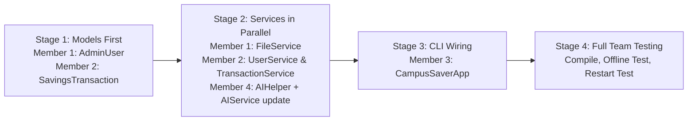

# CampusSaver — Master Team Build Checklist & Integration Guide

> **Synced to repo commit:** `feb1c9b` (`origin/main`)  
> **Java Version:** **JDK 17+** *(required because `AIService.java` uses Java 16+ `instanceof` pattern matching)*  
> **Rule #1 (WIX1002):** Zero `ArrayList`, `LinkedList`, `HashMap`, or `List` anywhere in `src/`. Plain arrays (`User[]`, `Transaction[]`) + `int count` only!

---

## 1. Current Repo Status (`src/campussaver/`)

| File | Owner | Current Status | Notes |
| :--- | :--- | :---: | :--- |
| `exception/AIServiceException.java` | Shared | Done | Checked exception (`extends Exception`) |
| `exception/LowRunwayException.java` | Shared | Done | Checked exception (`extends Exception`) |
| `model/User.java` | Shared | Done | Abstract parent (`userId`, `name`, `baseCurrency`) |
| `model/StudentUser.java` | Shared | Done | Subclass 1 (`livingType`, `hasScholarship`, `monthlyBudgetLimit`) |
| `model/Transaction.java` | Shared | Done | Abstract parent (`id`, `amount`, `date`, `description`) |
| `model/ExpenseTransaction.java` | Shared | Done | Subclass 1 (`category`, `isVerifiedAcademic`) |
| `model/AdminUser.java` | **Member 1** | **To Build** | Subclass 2 of `User` |
| `service/FileService.java` | **Member 1** | **To Build** | Loads/saves `data/users.txt`, `data/transactions.txt`, `data/report.txt` |
| `model/SavingsTransaction.java` | **Member 2** | **To Build** | Subclass 2 of `Transaction` (Spare-Change Round-Up) |
| `service/UserService.java` | **Member 2** | **To Build** | Manages `User[]` + `int userCount` |
| `service/TransactionService.java` | **Member 2** | **To Build** | Manages `Transaction[]` + `int transactionCount` + `LowRunwayException` |
| `service/AIHelper.java` | **Member 4** | **To Build** | `ask(String)` via `HttpURLConnection`, `config.txt`, manual JSON, `ai_log.txt` |
| `service/AIService.java` | **Member 4** | **Update Needed** | Plain arrays already done (`feb1c9b`)! Still needs `AIHelper.ask()` + offline fallback |
| `main/CampusSaverApp.java` | **Member 3** | **Update Stub** | Currently prints 1 line; needs full `Scanner` CLI + Multi-Currency display |

---

## 2. Build Order (So Nobody Gets Blocked)



- **Day 1–2 (Stage 1):** Member 1 merges `AdminUser.java`; Member 2 merges `SavingsTransaction.java`. *(Once those two small files are on `main`, nobody is blocked!)*
- **Day 3–6 (Stage 2):** Member 1 builds `FileService`, Member 2 builds `UserService` + `TransactionService`, Member 4 builds `AIHelper` + updates `AIService`.
- **Day 7–10 (Stage 3):** Member 3 wires all services inside `CampusSaverApp.java`.
- **Day 11+ (Stage 4):** Whole team runs the End-to-End Integration Checklist below.

---

## 3. Individual Member Checklists

Open your own file and check off every box one by one:
- [ ] **Member 1 (Storage & Admin):** [MEMBER1_CHECKLIST.md](checklists/MEMBER1_CHECKLIST.md) — `AdminUser.java`, `FileService.java`
- [ ] **Member 2 (Core Engine & Round-Up):** [MEMBER2_CHECKLIST.md](checklists/MEMBER2_CHECKLIST.md) — `SavingsTransaction.java`, `UserService.java`, `TransactionService.java`
- [ ] **Member 3 (Scanner CLI & Currency):** [MEMBER3_CHECKLIST.md](checklists/MEMBER3_CHECKLIST.md) — `CampusSaverApp.java`
- [ ] **Member 4 (AI Helper & Insights):** [MEMBER4_CHECKLIST.md](checklists/MEMBER4_CHECKLIST.md) — `AIHelper.java`, `AIService.java`

---

## 4. Locked Shared Method Signatures (Do NOT Rename!)

If everyone uses these exact method names and parameters, all 4 branches will compile cleanly together:

| Class | Exact Method Signatures Other Members Call |
| :--- | :--- |
| `AdminUser` | `new AdminUser(String userId, String name, String baseCurrency, String department)` |
| `SavingsTransaction` | `new SavingsTransaction(String id, double amount, String date, String description, String sourceType, String goalName)` |
| `FileService` | `ensureDataFolder()`, `int loadUsers(User[] users)`, `void saveUsers(User[] users, int userCount)`, `int loadTransactions(Transaction[] transactions)`, `void saveTransactions(Transaction[] transactions, int count)`, `void saveReport(String reportContent)` |
| `UserService` | `StudentUser registerStudent(String name, String livingType, boolean hasScholarship, double budgetLimit)`, `AdminUser registerAdmin(String name, String department)`, `User findUserById(String userId)`, `User[] getUsers()`, `int getUserCount()`, `void setLoadedCount(int count)` |
| `TransactionService` | `ExpenseTransaction addExpense(StudentUser user, double amount, String date, String description, String category, boolean isAcademic) throws LowRunwayException`, `SavingsTransaction addRoundUpSaving(double expenseAmount, String date, String sourceDesc)`, `double getTotalExpenses()`, `double getTotalAcademicExpenses()`, `double getTotalSavings()`, `int searchByKeyword(String keyword, Transaction[] results)`, `boolean deleteById(String id)`, `Transaction[] getTransactions()`, `int getTransactionCount()`, `void setLoadedCount(int count)` |
| `AIHelper` | `String ask(String prompt) throws AIServiceException` |
| `AIService` | `double calculateAcademicRatio(Transaction[] transactions, int count) throws AIServiceException`, `int calculateRemainingRunwayDays(StudentUser user, Transaction[] transactions, int count, int daysPassedInMonth) throws AIServiceException`, `String generateFinancialAdvice(StudentUser user, Transaction[] transactions, int count, int daysPassedInMonth) throws AIServiceException` |

---

## 5. Final Integration & WIX1002 Rubric Verification (Whole Team)

Run these checks together after merging all 4 branches into `main`:

- [ ] **Clean Compile Check (from `CampusSaver/` root):**
  ```bash
  mkdir out
  javac --release 17 -d out src/campussaver/exception/*.java src/campussaver/model/*.java src/campussaver/service/*.java src/campussaver/main/*.java
  ```
  Must finish with **0 errors**.
- [ ] **Zero-Collections Check (WIX1002 Hard Rule):**
  Search `src/` for `ArrayList`, `LinkedList`, `HashMap`, `HashSet`, or `java.util.List` — must return **0 matches**.
- [ ] **Test 1 — First-Run Onboarding & Low Runway Warning:**
  Delete `data/` folder, run `java -cp out campussaver.main.CampusSaverApp`, create a `StudentUser` (`budget = 100.0`), add an expense of `90.0` -> verify `LowRunwayException` prints a clear warning without crashing, then add `Y` for Spare-Change Round-Up on an expense like `7.40` -> verify `RM 0.60` `SavingsTransaction` is added.
- [ ] **Test 2 — Restart Persistence:**
  Choose Option 6 (`Save & Exit`), verify `data/users.txt` and `data/transactions.txt` exist, re-run the program, and verify your user and transactions reload automatically in Option 2!
- [ ] **Test 3 — Multi-Currency & Search/Delete:**
  Switch display currency in Option 2 (`MYR` -> `USD` / `SGD` / `IDR`), then search and delete a transaction in Option 3 without leaving `null` crashes in Option 2.
- [ ] **Test 4 — Offline AI Fallback (`AIServiceException`):**
  Remove/rename `config.txt` (or disconnect Wi-Fi) -> run Option 4 -> confirm `AIHelper` throws `AIServiceException`, `CampusSaverApp` / `AIService` catches it cleanly, displays offline math advice, and logs the notice in `data/ai_log.txt`.
- [ ] **Test 5 — Live AI Test + Key Safety:**
  Copy `config.example.txt` to `config.txt`, insert real API key, run Option 4 -> verify real AI reply prints AND appends to `data/ai_log.txt`. Run `git status` and confirm `config.txt` is **NOT** tracked by Git.
- [ ] **Test 6 — Admin Report (`report.txt`):**
  Log in as `AdminUser` -> run Option 5 -> verify `data/report.txt` is generated and readable.
